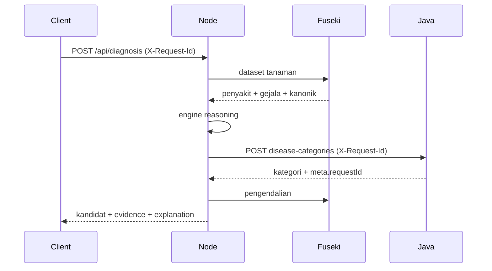

# Kontrak Integrasi Node.js ↔ Java

Dokumen ini adalah acuan komunikasi antara Node/Express (`06_backend/node-api`)
dan Java/Spring Boot (`06_backend/reasoning-api`). Perubahan pada salah satu
sisi harus memperbarui dokumen ini dan test terkait.

## 1. Pembagian tanggung jawab

| Komponen | Tanggung jawab |
|---|---|
| Node | Validasi request, retrieval Fuseki, reasoning diagnosis, orkestrasi response |
| Java | Memuat ontology, cek konsistensi, inferensi kategori penyakit dengan Openllet |
| Fuseki | Menyimpan RDF dan melayani SPARQL read-only |

Node **tidak** mengirim individual gejala ke Java. Java hanya diminta kategori
penyakit dan status ontology.

## 2. Base URL dan autentikasi

| Sisi | Default | Env |
|---|---|---|
| Node → Java | `http://127.0.0.1:8082` | `REASONING_API_URL` |
| Java bind | `127.0.0.1:8082` | `SERVER_PORT`, `SERVER_ADDRESS` |

Kedua service bind ke loopback. Tidak ada autentikasi service-to-service pada
M6; jangan expose port Java ke jaringan publik.

## 3. Envelope response

Semua response Java memakai envelope yang sama dengan Node:

```json
{
  "success": true,
  "data": {},
  "meta": {
    "service": "kbr-reasoning-api",
    "requestId": "4e8f...",
    "timestamp": "2026-11-16T03:00:00Z"
  }
}
```

Error:

```json
{
  "success": false,
  "data": null,
  "error": {
    "code": "ONTOLOGY_NOT_LOADED",
    "message": "Ontology belum dimuat",
    "details": null
  },
  "meta": { "requestId": "..." }
}
```

## 4. Endpoint yang dipakai Node

### 4.1 `GET /api/reasoning/status`

Response `data`:

| Field | Tipe | Arti |
|---|---|---|
| `loaded` | boolean | Ontology sudah dimuat |
| `ready` | boolean | Dimuat dan konsisten |
| `consistent` | boolean | Hasil cek reasoner |
| `ontologyIri` | string/null | IRI ontology |
| `version` | string/null | `owl:versionInfo` atau prefix checksum |
| `checksum` | string/null | SHA-256 file yang dimuat |
| `sourceFile` | string/null | Nama file |
| `loadedAt` | string/null | Waktu load |
| `classCount` | number | Jumlah kelas |
| `individualCount` | number | Jumlah individu |
| `objectPropertyCount` | number | Jumlah object property |
| `dataPropertyCount` | number | Jumlah data property |
| `diseaseCategoryCounts` | object | Jumlah per kategori |
| `unclassifiedDiseaseCount` | number | Penyakit tanpa kategori |
| `lastError` | string/null | Error terakhir |

Node memakai endpoint ini untuk `/api/health/ready` dan
`/api/health/ontology`.

### 4.2 `POST /api/reasoning/disease-categories`

Request:

```json
{
  "diseaseIris": [
    "http://kbr.kelompok5.org/penyakit-tanaman-pangan#PenyakitBlasPadi"
  ]
}
```

- `diseaseIris` boleh kosong → semua kategori dikembalikan.
- Local name (`PenyakitBlasPadi`) juga diterima; Java menambahkan namespace PTP.

Response `data`:

```json
{
  "categories": {
    "http://.../PenyakitBlasPadi": "PenyakitJamur"
  },
  "counts": { "PenyakitJamur": 34 },
  "unclassifiedDiseaseCount": 15,
  "requestedCount": 1,
  "foundCount": 1,
  "missing": []
}
```

Penyakit tanpa relasi patogen yang dikenal tidak dikarang kategorinya; IRI-nya
masuk `missing` dan `category = null` di Node.

### 4.3 `POST /api/ontology/reload` (admin/diagnostik)

Memuat ulang ontology secara atomik. Response berisi status yang sama dengan
`/api/reasoning/status`. Node tidak memanggil endpoint ini saat diagnosis.

### 4.4 `GET /api/reasoning/consistency` dan `GET /api/ontology/status`

Endpoint diagnostik tambahan. Tidak dipakai jalur diagnosis.

## 5. Timeout dan retry

| Aturan | Nilai |
|---|---|
| Timeout per request | `REASONING_TIMEOUT_MS`, default 15.000 ms |
| Retry | 1 kali untuk network error/HTTP 502/503 |
| Backoff | 200 ms |
| Timeout | **tidak** diretry |
| HTTP 4xx | tidak diretry |
| Body bukan JSON | tidak diretry, `REASONING_INVALID_RESPONSE` |

Saat diagnosis gagal menghubungi Java, Node tetap mengembalikan `200` dengan:

```json
{
  "reasoning": { "status": "DEGRADED", "category": null },
  "warnings": ["REASONING_UNAVAILABLE"]
}
```

Penyebab spesifik dapat dilihat di `/api/health/ontology` dan log Node.

## 6. Request ID

- Node membuat/meneruskan `X-Request-Id` dari request client.
- Node mengirim header yang sama ke Java.
- Java mengembalikan header tersebut dan menaruhnya di `meta.requestId`.
- Jika header tidak ada/tidak aman, Java membuat UUID baru.

Dengan begitu log Node dan Java bisa dikorelasikan.

## 7. Health dan konsistensi versi

Node menyediakan:

### `GET /api/health/ontology`

Membandingkan:

- SHA-256 file di `ONTOLOGY_FILE_PATH` (Node),
- `checksum` yang dilaporkan Java,
- fingerprint Fuseki (`deskripsiPenyakit`, `memilikiKondisiTumbuh`).

Status:

| Status | Arti |
|---|---|
| `OK` | File = Java, Fuseki punya fingerprint enrichment |
| `MISMATCH` | Checksum file berbeda dengan Java |
| `UNKNOWN` | Node tidak diberi `ONTOLOGY_FILE_PATH` |
| `DOWN` | Java/Fuseki tidak siap |

`MISMATCH` membuat `/api/health/ready` mengembalikan `503`
`ONTOLOGY_MISMATCH`. `UNKNOWN` tidak memblokir readiness.

### `GET /api/health/ready`

Dependency yang dicek: `fuseki`, `reasoning`, `ontology`. Response `503` jika
salah satu DOWN atau ontology MISMATCH.

## 8. Sequence diagnosis



## 9. Environment

| Variabel | Sisi | Default |
|---|---|---|
| `REASONING_API_URL` | Node | `http://localhost:8082` |
| `REASONING_TIMEOUT_MS` | Node | `15000` |
| `ONTOLOGY_FILE_PATH` | Node | kosong (status `UNKNOWN`) |
| `SERVER_PORT` | Java | `8082` |
| `SERVER_ADDRESS` | Java | `127.0.0.1` |
| `ONTOLOGY_FILE_PATH` | Java | `E:/kbr-kelompok5/04_ontology/ontology_md_inferred.ttl` |
| `ONTOLOGY_REASONING_TIMEOUT_MS` | Java | `600000` |
| `ONTOLOGY_FAIL_FAST` | Java | `false` |

## 10. Aturan perubahan

1. Ubah Java dan Node bersamaan; jangan mengubah field yang sudah dipakai tanpa
   masa transisi.
2. Perbarui dokumen ini dan test client.
3. Jalankan `npm test`, `mvnw test`, `integration-test.ps1`, dan smoke test.
4. Jika endpoint/error code berubah, perbarui `06_backend/README.md`.
