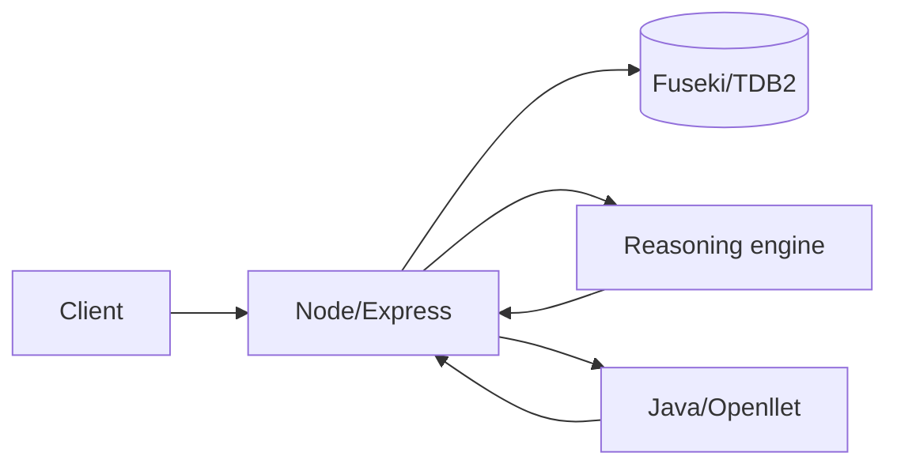
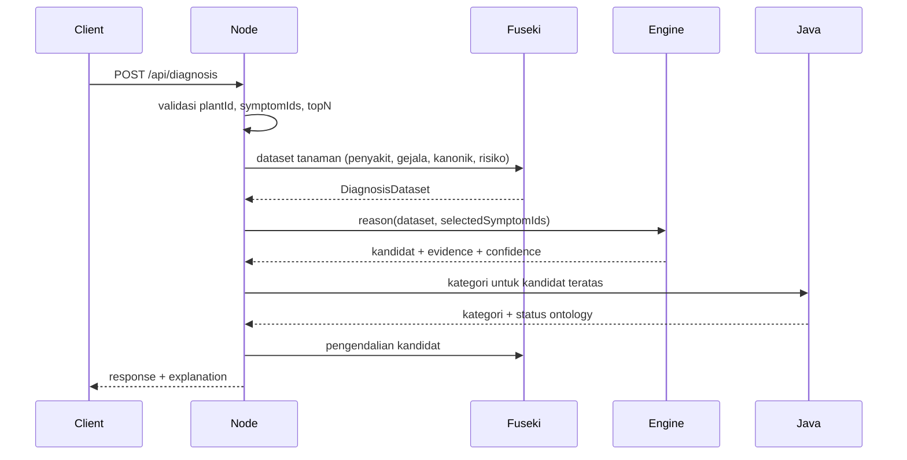

# Reasoning Diagnosis — Milestone 5

Dokumen ini menjelaskan implementasi reasoning diagnosis pada backend sistem
pakar penyakit tanaman pangan. Fokusnya backend: bagaimana gejala yang dipilih
diubah menjadi kandidat penyakit, bagaimana keyakinan dihitung, dan bagaimana
hasilnya divalidasi.

Ontology yang dipakai adalah `04_ontology/ontology_md.ttl` (checksum
`bbf9c78e...`), hasil penggabungan ontology final dengan enrichment. Backend
tetap dibuat tahan ganti ontology: kosakata dipusatkan di
`src/config/ontology.ts`, dan properti opsional boleh hilang tanpa mematikan
diagnosis.

## 1. Ruang lingkup

Yang termasuk M5:

- Pencocokan gejala **exact** dan **kanonik**.
- Pembobotan specificitas gejala.
- Kombinasi bukti dengan certainty factor (CF).
- `confidence`, `evidence`, dan `explanation` di response.
- Input fase pertumbuhan opsional sebagai faktor ranking lembut.
- Harness validasi dengan metrik top-1, top-3, dan MRR.

Yang tidak termasuk M5:

- Frontend.
- Input kondisi lingkungan.
- SWRL untuk ranking.
- Perbaikan 64 gejala yang belum dipetakan.
- Ontology final.

## 2. Sumber pengetahuan

| Item | Nilai |
|---|---:|
| Triple ontology | 19.021 |
| Kelas | 87 |
| Individu | 1.366 |
| Tanaman | 7 |
| Penyakit | 53 |
| Pengamatan gejala | 229 |
| Pengamatan dengan konsep kanonik | 171 |
| Konsep kanonik terpakai | 24 |
| Tautan penyakit-patogen | 76 |
| Tautan pengendalian | 226 |
| Tautan faktor risiko (`dipengaruhiOleh`) | 82 |
| Individu fase pertumbuhan | 5 |
| Tautan penyakit–fase (`menyerangFase`) | 12 |
| `deskripsiPenyakit` | 53 |
| `tingkatKeparahan` | 14 |
| Penyakit tanpa kategori | 0 |
| Penyakit tanpa patogen | 0 |

Catatan data:

- Pengamatan gejala bersifat **spesifik per penyakit**
  (`PengamatanPenyakitBlasPadiBercakDaun`,
  `PengamatanPenyakitHawarDaunBakteriPadiBercakDaun`). Karena itu exact match
  berdasarkan ID tidak cukup; dibutuhkan konsep kanonik.
- `tingkatKeparahan` masih berupa teks bebas dan berstatus `needs_review`.
  Nilainya belum dipakai sebagai bobot numerik.
- `dipengaruhiOleh` terkadang menunjuk observasi lingkungan, bukan individu
  `FaktorRisiko`. Di M5, data ini hanya dipakai sebagai konteks/penjelasan.
- Fase pertumbuhan hanya tersedia untuk 5 dari 7 tanaman (12 tautan penyakit).
  Ubi Jalar dan Ubi Kayu belum punya data fase. Karena itu `phaseId` bersifat
  opsional; fase tidak pernah menjadi filter keras.
- Fase yang cocok memberi faktor ranking `1.05`; fase berbeda atau kandidat
  tanpa data fase tidak dihukum.

## 3. Arsitektur



Pembagian tanggung jawab:

| Komponen | Tanggung jawab |
|---|---|
| Fuseki/TDB2 | Menyimpan RDF dan melayani SPARQL read-only |
| Node/Express | Validasi, retrieval, reasoning diagnosis, orkestrasi response |
| Java/Openllet | Memuat ontology, cek konsistensi, inferensi kategori penyakit |
| Engine Node | Pencocokan gejala, specificitas, CF, ranking, explanation |

Alasan engine berada di Node: data gejala dan penyakit sudah diambil lewat
SPARQL, dan ranking diagnosis membutuhkan agregasi yang tidak cocok dengan
reasoner OWL. Java tetap dipakai untuk hal yang memang deduktif: klasifikasi
kategori dan konsistensi ontology.

## 4. Alur diagnosis



Jika Java mati, Node tetap mengembalikan `200` dengan
`reasoning.status = "DEGRADED"`, `category = null`, dan warning
`REASONING_UNAVAILABLE`. Jika Fuseki mati, request gagal `503`
`FUSEKI_UNAVAILABLE`.

## 5. Aturan reasoning

| Aturan | Isi |
|---|---|
| R1 | Hanya penyakit pada tanaman yang dipilih yang dipertimbangkan |
| R2 | Exact match: pengamatan yang dipilih sama dengan pengamatan penyakit |
| R3 | Canonical match: ID berbeda, konsep `memilikiGejalaKanonik` sama |
| R4 | Exact menang atas kanonik; satu observasi penyakit hanya dipakai sekali |
| R5 | Gejala yang tidak cocok masuk `unexplainedSymptoms` |
| R6 | Bukti digabung dengan CF positif |
| R7 | Completeness dan coverage menghukum penjelasan yang lemah/terlalu lebar |

Aturan tidak ditulis manual per penyakit. Engine membangun index dari dataset:
observasi → penyakit, kanonik → penyakit, dan observasi per penyakit per
kanonik. Dengan begitu, ontology baru cukup di-load ulang.

## 6. Skor dan keyakinan

### 6.1 Specificitas

```text
N  = jumlah penyakit bertanda gejala pada tanaman
df = jumlah penyakit yang memiliki konsep gejala tersebut

ratio = log((N + 1) / (df + 1)) / log(N + 1)
spec  = 0.5 + 0.5 * ratio
```

- `df = 1` → `spec = 1.0` (gejala khas).
- `df = N` → `spec = 0.5` (gejala umum).
- Exact match memakai `df` konsep kanonik bila ada; jika tidak, `df`
  observasi.
- Bobot satu bukti dibatasi `0.9`.

### 6.2 Bukti dan CF

```text
bobot_dasar = 1.0  (exact)
            = 0.6  (kanonik)

w  = min(0.9, bobot_dasar * spec)
CF = 1 - produk(1 - w)
```

Urutan bukti tidak memengaruhi CF. Satu observasi penyakit tidak dihitung dua
kali, termasuk saat dua gejala terpilih memiliki kanonik yang sama.

### 6.3 Skor akhir

```text
completeness = matched / jumlah gejala terpilih
coverage     = matched / max(jumlah gejala penyakit, 4)
faktor_fase  = 1.05 jika fase cocok, selain itu 1.0

score = CF * (0.7 + 0.3 * completeness) * (0.5 + 0.5 * coverage) * faktor_fase
```

Penyebut minimum 4 adalah penalti kelengkapan data: penyakit dengan 1–2 gejala
tercatat tidak otomatis mendapat `coverage = 1.0`.

Fase pertumbuhan tidak dihitung sebagai bukti gejala. Fase hanya memberi
faktor ranking kecil saat `phaseId` yang dipilih cocok dengan `menyerangFase`
milik penyakit. Kandidat dengan fase berbeda atau tanpa data fase tetap
mendapat faktor `1.0`; tidak ada penalti dan tidak ada filter keras.

### 6.4 Keyakinan

| Label | Syarat |
|---|---|
| `TINGGI` | `score >= 0.7` dan bukti >= 2 |
| `SEDANG` | `score >= 0.4` dan bukti >= 2 |
| `RENDAH` | selain itu |

Satu bukti selalu `RENDAH`, sekalipun gejalanya sangat khas. Ini disengaja agar
sistem tidak terlalu percaya diri.

## 7. Contoh perhitungan

Kasus `PADI-BLAS-02`:

- Gejala terpilih:
  - `BercakDaun` milik HDB (kanonik `Bercak daun`)
  - `KhasMalai` milik Blas (exact)
  - `BerwarnaAbuAbuPutihBagian` milik Blas (exact)
- `N = 5`, `df(BercakDaun) = 4` → `spec = 0,5509`.
- Bobot kanonik = `0,6 × 0,5509 = 0,3305`.
- Bobot exact = `0,9` (dua bukti).
- `CF = 1 − (1−0,3305)(1−0,9)(1−0,9) = 0,9933`.
- `completeness = 3/3 = 1`.
- `coverage = 3/max(6,4) = 0,5`.
- `score = 0,9933 × (0,7+0,3) × (0,5+0,25) × 1,0 = 0,745`.
- `confidence = TINGGI` (3 bukti, skor >= 0,7).

Explanation yang dihasilkan:

> 2 gejala cocok persis dan 1 gejala cocok pada konsep Bercak daun. Kandidat ini
> menjelaskan seluruh gejala yang dipilih.

## 8. Kontrak API

`POST /api/diagnosis`

```json
{
  "plantId": "Padi",
  "phaseId": "FaseAnakan",
  "symptomIds": [
    "PengamatanPenyakitBlasPadiBercakDaun",
    "PengamatanPenyakitBlasPadiKhasMalai"
  ],
  "topN": 5
}
```

`phaseId` opsional. Jika diisi, nilainya harus fase yang tersedia untuk
tanaman tersebut; fase milik tanaman lain menghasilkan `400`.

Field penting per kandidat:

| Field | Arti |
|---|---|
| `score` | Skor akhir 0–1, sudah termasuk faktor fase bila cocok |
| `confidence` | `TINGGI` / `SEDANG` / `RENDAH` |
| `phaseMatch` | `match` / `mismatch` / `unknown` |
| `scoreComponents` | `evidence` (CF), `completeness`, `coverage`, `phase` |
| `matchedSymptoms` | Gejala yang dipilih dan dijelaskan kandidat |
| `unmatchedSelectedSymptoms` | Gejala yang dipilih tetapi tidak dijelaskan |
| `evidence` | Bukti `exact`/`canonical` + `ruleId` + bobot + `cfAfter` |
| `explanation` | Narasi alasan dalam bahasa Indonesia |
| `category` | Kategori hasil inferensi Openllet, atau `null` |
| `controls` | Pengendalian dari ontology |
| `riskFactors` | Faktor risiko/pemicu dari relasi `dipengaruhiOleh`; hanya informasi, bukan komponen skor |

`input.phaseId`, `input.phaseIri`, dan `input.phaseLabel` berisi fase yang
dipakai (atau `null`). `reasoning.modelVersion` menandai versi model
(`forward-chaining-cf-v1`), dan `reasoning.ontologyVersion`/`checksum` menandai
ontology yang dimuat Java.
`evidence.matchedObservationId` menunjukkan observasi milik penyakit yang
menjadi dasar kecocokan; ini penting untuk match kanonik.

## 9. Validasi

Harness ada di `05_reasoning_tests/`.

| Tipe | Jumlah | Fungsi |
|---|---:|---|
| Gold | 14 | Kasus manual, 2 per tanaman |
| Ambiguous | 8 | Gejala generik dari penyakit lain; uji pencocokan kanonik |
| Sanity | 53 | Satu kasus per penyakit; regression |
| Negative | 5 | Validasi input/error |

Hasil 19 November 2026:

| Metrik | Baseline 0,7/0,3 | Model baru |
|---|---:|---:|
| Top-1 fokus (gold + ambiguous) | 0,636 | **0,909** |
| Top-3 fokus | 0,909 | **1,000** |
| MRR fokus | 0,742 | **0,955** |
| Top-1 ambiguous | 0,000 | **0,750** |
| Top-3 ambiguous | 0,750 | **1,000** |
| Top-1 gold | 1,000 | 1,000 |
| Top-1 sanity | 1,000 | 1,000 |
| Negative tests | — | 5/5 lulus |

Kasus ambiguous adalah bukti utama: gejala yang dipilih berasal dari penyakit
lain, sehingga model lama (exact match) tidak menemukan target di top-1 sama
sekali, sedangkan model baru menemukannya di top-1 untuk 6 dari 8 kasus.

Dua kasus masih rank 2 (tetap top-3):

- `PADI-PURE-HDB-01`: Kerdil menang karena coverage `2/4` versus HDB `2/9`.
- `KACANGTANAH-PURE-KARAT-01`: Bercak Daun menang karena 2 exact versus 2
  kanonik pada Karat.

Kalibrasi confidence pada kasus fokus:

| Confidence | Kasus | Top-1 | Top-3 |
|---|---:|---:|---:|
| `TINGGI` | 12 | 100% | 100% |
| `SEDANG` | 9 | 88,9% | 100% |
| `RENDAH` | 1 | 0% | 100% |

Artefak: `05_reasoning_tests/results.md`, `results.json`,
`cases/manual.json`, `cases/ambiguous.json`, `cases/sanity.json`,
`cases/negative.json`.

Performa pada mesin pengembangan: p50 sekitar **20–25 ms**, p95 sekitar
**40–55 ms** (20 sampel; nilainya bervariasi antarrun). Determinism stabil pada
kasus yang sama.

## 10. Keterbatasan

1. **Ontology sementara.** ID dan cakupan bisa berubah saat TTL final masuk.
2. **Gold dan sanity di-seed dari ontology.** Angka 100% pada gold/sanity bukan
   akurasi independen. Halaman DOC002 belum diverifikasi.
3. **58 dari 229 pengamatan belum punya konsep kanonik.** Untuk gejala ini,
   hanya exact match yang bekerja.
4. **0 penyakit tanpa kategori, 0 tanpa patogen.** Semua penyakit sudah punya
   patogen dan kategori; response tetap null-safe untuk data baru.
5. **Faktor risiko dan severity sparse.** `tingkatKeparahan` masih teks bebas.
6. **Open-world assumption.** Gejala yang tidak dipilih bukan bukti negatif;
   penalti completeness hanya eksplisit di skor, bukan inferensi OWL.
7. **Sampel kecil.** 22 kasus fokus belum cukup untuk klaim generalisasi.
8. **Konstanta skor awal.** Bobot dan ambang belum dikalibrasi formal.
9. **Uji performa terbatas.** Satu mesin, tanpa beban konkuren.

## 11. Reproduksi

```powershell
# 1. Muat ontology ke Fuseki (Fuseki harus berhenti)
.\06_backend\scripts\load-ontology.ps1 -Reset
.\06_backend\scripts\start-fuseki.ps1

# 2. Java reasoning API
cd .\06_backend\reasoning-api
.\mvnw.cmd spring-boot:run

# 3. Node API (terminal lain)
cd .\06_backend\node-api
npm run dev

# 4. Smoke test
cd E:\kbr-kelompok5
.\06_backend\scripts\smoke-test.ps1

# 5. Validasi reasoning
cd .\05_reasoning_tests
node run.mjs --perf
```

Konfigurasi utama:

| Variabel | Default |
|---|---|
| `PORT` | `3000` |
| `FUSEKI_BASE_URL` | `http://localhost:3030` |
| `FUSEKI_DATASET` | `plant-kb` |
| `REASONING_API_URL` | `http://localhost:8082` |
| `ONTOLOGY_FILE_PATH` (Java) | `E:/kbr-kelompok5/04_ontology/ontology_md.ttl` |

Cek ontology yang benar-benar dimuat:

```powershell
(Get-FileHash .\04_ontology\ontology_md.ttl -Algorithm SHA256).Hash
Invoke-RestMethod http://127.0.0.1:8082/api/reasoning/status
```

Checksum Java harus sama dengan hash file. Jika berbeda, jangan menganggap
sistem siap.

## 12. Keputusan desain

| Keputusan | Alasan |
|---|---|
| Scoring di Node, bukan Java | Ranking butuh agregasi; OWL reasoner tidak cocok untuk skor |
| Java tetap untuk kategori/konsistensi | Memanfaatkan inferensi OWL yang memang deduktif |
| Specificitas dari konsep kanonik | Pengamatan spesifik per penyakit; `df` observasi selalu 1 |
| Coverage minimal 4 | Mencegah penyakit dengan data miskin mendapat coverage 1,0 |
| Satu bukti selalu `RENDAH` | Menghindari diagnosis terlalu percaya diri |
| Tidak memakai SWRL untuk ranking | SWRL tidak melakukan agregasi/skor |
| Kosakata di `config/ontology.ts` | Memudahkan penggantian ontology sementara |
| Engine fungsi murni | Bisa diuji tanpa Fuseki; 17 test engine + 8 test client |

## 13. Status

M5 selesai untuk ruang lingkup backend:

- Engine reasoning aktif di `POST /api/diagnosis`.
- Validasi dan dokumentasi tersedia.
- 39 test Node, 4 test Java, 115 test `03_knowledge_tables` (8 skip), dan
  68 test `04_ontology` lulus.
- Ontology final sudah masuk; `generate-sanity.mjs` dan `run.mjs` dijalankan
  ulang pada 19 Nov 2026.

M6 (integrasi Node–Java) sudah diimplementasikan pada lingkup inti:

- kontrak HTTP: `08_documentation/node-java-contract.md`,
- health checksum/fingerprint: `GET /api/health/ontology`,
- request ID diteruskan Node → Java,
- integration test: `06_backend/scripts/integration-test.ps1`,
- runbook: `08_documentation/node-java-runbook.md`.

Detail arsitektur dan operasional ada di dokumen M6 tersebut.
