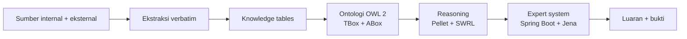

# Materi Presentasi KBR — Sistem Pakar Penyakit Tanaman Pangan

**Durasi:** 8–10 menit  
**Format:** 9 slide utama + 3 backup slide  
**Audiens:** dosen/penguji akademik  
**Fokus:** pipeline knowledge base, TBox/ABox, SROIQ(D), SWRL, hasil, dan gap

> Catatan: PDF `docs/Progress - A - 5.pdf` tidak dapat dibaca langsung oleh model ini. Materi disusun dari `README.md`, `04_ontology/README.md`, `03_knowledge_tables/README.md`, `06_backend/README.md`, `tbox.py`, dan `swrl_rules.ttl`.

---

## 0. Ringkasan alur presentasi



Narasi besar:

1. Masalah: pengetahuan penyakit tersebar dan sulit ditelusuri.
2. Solusi: pipeline deterministik yang menghasilkan ontologi dan prototipe expert system.
3. Bukti: setiap klaim dapat dilacak ke kutipan, halaman, chunk, dan offset.
4. Status: knowledge base, reasoning, inferred graph, dan endpoint diagnosis selesai; frontend belum.

---

## 1. Peta slide dan alokasi waktu

| Slide | Isi | Durasi |
|---|---|---:|
| 1 | Judul dan identitas | 30 detik |
| 2 | Latar belakang, masalah, ruang lingkup | 60 detik |
| 3 | Pipeline dan prinsip deterministik | 75 detik |
| 4 | TBox vs ABox | 90 detik |
| 5 | SROIQ(D) | 90 detik |
| 6 | SWRL dan hasil reasoning | 75 detik |
| 7 | Angka dan rantai bukti | 60 detik |
| 8 | Status, keterbatasan, gap | 75 detik |
| 9 | Rencana lanjutan dan penutup | 45 detik |
| **Total** | | **±10 menit** |

---

## Slide 1 — Judul

**Tujuan:** memperkenalkan proyek, kelompok, dan fokus presentasi.

**Visual:**
- Latar cream dengan blok hijau tua.
- Judul besar: “Knowledge Base dan Prototipe Expert System Penyakit Tanaman Pangan”.
- Subjudul: “Dari sumber verbatim ke ontologi OWL 2 dan reasoning”.
- Identitas kelompok dan mata kuliah.

**Poin di slide:**
- 7 tanaman pangan tropis.
- 53 penyakit.
- Ontologi OWL 2 + SWRL.
- Spring Boot + Apache Jena.

**Speaker notes:**

> Selamat pagi/siang. Kami dari Kelompok 5 akan mempresentasikan progres pembangunan knowledge base dan prototipe expert system untuk diagnosis awal penyakit pada tujuh tanaman pangan tropis: padi, kedelai, jagung, ubi jalar, ubi kayu, kacang tanah, dan kacang hijau. Fokus presentasi hari ini bukan hanya jumlah data, tetapi bagaimana pengetahuan dari buku diproses menjadi ontologi yang bisa di-reasoning dan ditelusuri buktinya.

**Transisi:**

> Saya mulai dari masalah yang ingin diselesaikan.

---

## Slide 2 — Latar belakang, masalah, ruang lingkup

**Tujuan:** menjelaskan mengapa proyek ini perlu dan apa batas cakupannya.

**Visual:**
- Tiga kartu angka: 7 tanaman, 53 penyakit, 78 tautan penyakit–patogen.
- Alur masalah: pengetahuan tersebar → sulit ditelusuri → sulit di-reasoning → sulit dipakai aplikasi.
- Kotak “Ruang lingkup”: hanya 7 tanaman; tanaman di luar cakupan tidak dibuat sebagai individu.

**Poin di slide:**
- Pengetahuan penyakit tersebar di buku, tabel, dan sumber eksternal.
- Database biasa menyimpan data, tetapi tidak menalar definisi dan relasi.
- Target: knowledge base yang terstruktur, konsisten, dan punya jejak bukti.
- Batas: diagnosis awal, bukan kepastian laboratorium.

**Speaker notes:**

> Pengetahuan penyakit tanaman sebenarnya sudah ada di buku dan sumber eksternal. Masalahnya, bentuknya tersebar: ada di tabel, prosa, dan lampiran. Kalau hanya dibaca manual, kita sulit menjawab pertanyaan seperti “penyakit apa yang menyerang daun padi dan punya gejala bercak”, atau “bukti kutipannya di halaman mana”. Karena itu kami membangun knowledge base yang tidak hanya menyimpan fakta, tetapi juga mendefinisikan konsep dan relasinya. Ruang lingkupnya sengaja dibatasi ke tujuh tanaman pangan agar kualitas data bisa dijaga.

**Transisi:**

> Berikutnya saya jelaskan pipeline yang kami gunakan.

---

## Slide 3 — Pipeline dan prinsip deterministik

**Tujuan:** menunjukkan alur kerja dari sumber sampai expert system.

**Visual:**
- Enam blok horizontal: Sumber → Ekstraksi → Knowledge Tables → Ontologi → Reasoning → Expert System.
- Panah tegas, gaya block diagram hijau–cream.
- Pill di atas: “deterministik · verbatim · traceable”.
- Subteks di bawah: “Tanpa LLM/RAG di dalam pipeline”.

**Poin di slide:**
1. Sumber: DOC002–DOC005 + 45 sumber eksternal.
2. Ekstraksi: LlamaParse, output halaman/blok/chunk.
3. Knowledge tables: `auto → review → curated`.
4. Ontologi: TBox manual + ABox generated.
5. Reasoning: Pellet + 7 aturan SWRL, lalu materialisasi ke inferred TTL.
6. Expert system: Spring Boot + Jena.

**Speaker notes:**

> Pipeline kami sengaja deterministik. Artinya, teks yang masuk tabel harus benar-benar substring dari sumber. Kami tidak memakai LLM, RAG, atau embedding di dalam pipeline. Setiap baris menyimpan `chunk_id`, offset karakter, halaman, dan kutipan. Jadi kalau ada pertanyaan “dari mana angka ini”, kami bisa lacak sampai blok teks sumbernya. TBox didefinisikan manual di `tbox.py`; ABox dibangkitkan oleh `build_ontology.py` dari knowledge tables yang sudah dikurasi. Setelah itu `build_ontology_md.py` menambahkan enrichment dan tujuh aturan SWRL.

**Transisi:**

> Bagian paling penting dari ontologi adalah pembagian TBox dan ABox.

---

## Slide 4 — TBox vs ABox

**Tujuan:** membuat audiens paham perbedaan skema dan data.

**Visual:**
- Dua kolom besar: TBox (kiri) dan ABox (kanan).
- TBox: 87 kelas, 32 object property, 34 data property.
- ABox: 1.205 individu, 16.812 triple.
- Contoh di bawah:
  - TBox: `PenyakitJamur ≡ Penyakit ⊓ ∃disebabkanOleh.Jamur`
  - ABox: `PenyakitBlasPadi disebabkanOleh MagnaportheOryzae`; `MagnaportheOryzae rdf:type Jamur`
  - Reasoner: `PenyakitBlasPadi rdf:type PenyakitJamur`

**Poin di slide:**
- **TBox** = *terminological box*: definisi, skema, aksioma.
- **ABox** = *assertional box*: fakta, individu, relasi.
- Analogi: TBox adalah blueprint; ABox adalah isi data.
- TBox stabil; ABox berubah saat data bertambah.
- Reasoner menurunkan fakta baru dari kombinasi keduanya.

**Speaker notes:**

> TBox adalah bagian terminologi. Isinya definisi: apa itu penyakit, apa itu gejala, properti apa yang boleh dipakai, dan aksioma seperti “penyakit jamur adalah penyakit yang disebabkan oleh jamur”. ABox adalah bagian assertion. Isinya fakta konkret: Penyakit Blas pada padi disebabkan oleh Magnaporthe oryzae, dan Magnaporthe oryzae adalah jamur. Dari dua bagian ini, reasoner bisa menyimpulkan bahwa Penyakit Blas termasuk PenyakitJamur, walaupun fakta itu tidak ditulis eksplisit di ABox. Itulah bedanya dengan database biasa: kita mendefinisikan aturan, lalu mesin yang menurunkan klasifikasi.

**Transisi:**

> Pertanyaan berikutnya: fitur logika apa yang membuat inferensi ini mungkin? Jawabannya SROIQ(D).

---

## Slide 5 — SROIQ(D)

**Tujuan:** menjelaskan DL expressivity yang dipakai ontologi.

**Visual:**
- Enam kartu, 2 baris × 3 kolom.
- Setiap kartu: huruf besar, arti, contoh proyek.
- Catatan bawah: “OWL 2 DL setara SROIQ(D); Pellet/HermiT mendukung”.

| Huruf | Arti | Contoh di proyek |
|---|---|---|
| **S** | `ALC` + peran transitif + hierarki peran | `bagianDari` transitif; `dikendalikanDengan ⊑ berkaitanPengendalian` |
| **R** | Property chain | `memilikiGejala ∘ terdapatPada ⊑ menyerangBagian` |
| **O** | Nominal | `Serealia ≡ {Padi, Jagung}`; `Legum ≡ {Kedelai, KacangTanah, KacangHijau}` |
| **I** | Inverse role | `menyerangTanaman` ↔ `diserangPenyakit`; 8 pasang `owl:inverseOf` |
| **Q** | Qualified cardinality | `Penyakit ⊑ ≥1 memilikiReferensi.Referensi`; `Buku ⊑ =1 tahunTerbit.xsd:integer` |
| **D** | Data range | `xsd:string`, `xsd:integer`, `xsd:decimal`, `xsd:anyURI`, `rdf:PlainLiteral` |

**Poin di slide:**
- `SROIQ(D)` adalah profil logika di balik OWL 2 DL.
- Lebih ekspresif daripada OWL 2 EL/QL/RL.
- Konsekuensi: reasoning lebih mahal, tetapi dataset masih wajar.
- Fitur dipakai nyata, bukan sekadar klaim: ada contoh di `tbox.py`.

**Speaker notes:**

> SROIQ(D) terdengar teknis, tetapi sebenarnya setiap huruf menjawab pertanyaan “apa yang bisa saya nyatakan?”. S berarti basis ALC dengan peran transitif dan hierarki peran. Contohnya, bagianDari bersifat transitif: daun bagian dari pucuk, pucuk bagian dari batang, maka daun bagian dari batang. R adalah property chain: kalau penyakit punya gejala, dan gejala itu terdapat pada daun, maka penyakit menyerang daun. O adalah nominal: Serealia tepat berisi Padi dan Jagung. I adalah inverse: menyerangTanaman dan diserangPenyakit adalah dua arah relasi yang sama. Q adalah qualified cardinality: setiap penyakit minimal punya satu referensi, dan setiap buku tepat punya satu tahun terbit. D adalah datatype: string, integer, decimal, anyURI. Kombinasi ini yang membuat ontologi bisa menalar, bukan hanya menyimpan.

**Transisi:**

> Setelah definisi dan fakta, kita masuk ke aturan dan hasil inferensi.

---

## Slide 6 — SWRL dan hasil reasoning

**Tujuan:** menunjukkan aturan if–then dan hasil inferensi kategori penyakit.

**Visual:**
- Kiri: tabel R1–R7.
- Kanan: kartu hasil materialisasi: 50 demo diagnosis, 162 `menghasilkanPenyakit`, 608 rekomendasi, 41 kandidat kuat, 175 varietas, 22 risiko lingkungan.
- Catatan bawah: “Pellet dijalankan offline; Jena hanya membaca `ontology_md_inferred.ttl`”.

| Aturan | Jika | Maka |
|---|---|---|
| **R1** Kandidat gejala | Diagnosis punya tanaman + observasi gejala; penyakit menyerang tanaman itu dan punya gejala kanonik yang sama | `menghasilkanPenyakit` |
| **R2** Kandidat lingkungan | Diagnosis punya observasi lingkungan; penyakit dipengaruhi faktor lingkungan dengan klasifikasi sama | `menghasilkanPenyakit` |
| **R3** Rekomendasi spesifik | Penyakit kandidat punya `dikendalikanDengan` aksi | `merekomendasikanPengendalian` |
| **R4** Rekomendasi umum | Penyakit kandidat menyerang tanaman; tanaman punya `pengendalianUmum` | `merekomendasikanPengendalian` |
| **R5** Kandidat kuat | Dua gejala kanonik berbeda milik penyakit yang sama; dibedakan dengan `swrlb:notEqual` pada `kodeGejala` | `kandidatKuat` |
| **R6** Varietas tahan | Penyakit kandidat punya varietas dengan `tahanTerhadap` | `merekomendasikanVarietas` |
| **R7** Risiko lingkungan | Kondisi lingkungan diagnosis cocok dengan `dipengaruhiOleh` penyakit | `menandaiRisikoLingkungan` |

**Hasil Pellet:**
- 50 demo diagnosis; semua tanaman punya penyakit hasil inferensi.
- `menghasilkanPenyakit`: 162; `merekomendasikanPengendalian`: 608.
- `kandidatKuat`: 41; `merekomendasikanVarietas`: 175.
- `menandaiRisikoLingkungan`: 22.
- Kategori penyakit tetap 26 jamur, 5 bakteri, 5 virus, 1 oomycete, 1 fitoplasma, 0 nematoda.

**Speaker notes:**

> OWL DL sudah bisa mengklasifikasikan penyakit berdasarkan definisi. Untuk diagnosis, kami menambahkan tujuh aturan SWRL. R1 mencocokkan gejala kanonik; R2 mencocokkan faktor lingkungan; R3 mengambil pengendalian spesifik; R4 menjadi fallback pengendalian umum tanaman. R5 menandai kandidat kuat jika ada dua gejala kanonik berbeda; karena Pellet tidak memakai `DifferentIndividualsAtom` pada jalur ini, pembedaannya memakai `swrlb:notEqual` pada kode gejala. R6 merekomendasikan varietas tahan, dan R7 menandai risiko lingkungan. Pellet dijalankan offline, hasilnya disimpan di `ontology_md_inferred.ttl`, lalu Jena hanya membaca graf itu.

**Transisi:**

> Berikutnya saya rangkum angka dan bukti yang membuat klaim ini bisa diaudit.

---

## Slide 7 — Angka dan rantai bukti

**Tujuan:** menunjukkan skala data dan provenance.

**Visual:**
- Empat kartu angka:
  - 16.812 triple kanonik
  - 1.205 individu kanonik
  - 19.326 triple enrichment
  - 1.367 individu enrichment
- Rantai bukti di bawah: PDF → chunk → offset CSV → `BuktiSumber` → `prov:wasDerivedFrom`.
- Angka pendukung: 783 node bukti; 1.407 tautan `didukungOleh`; 78 test ontology.

**Poin di slide:**
- Kanonik: 87 kelas, 32 object property, 34 data property.
- 240 baris gejala → 227 pengamatan; 176 grup kanonik; 51 belum dipetakan.
- 226 tautan `dikendalikanDengan`; 37 baris pengendalian belum dipetakan.
- Enrichment: 942 fakta, 559 deskripsi `rdfs:comment`, 7 aturan SWRL.
- Setiap pernyataan sumber dapat punya `kutipanSumber`, `halamanSumber`, `idChunkSumber`.

**Speaker notes:**

> Angka-angka ini penting karena menunjukkan bahwa knowledge base-nya bukan hanya skema kosong. Ada 16.812 triple kanonik dan 1.205 individu; setelah enrichment menjadi 19.326 triple dan 1.367 individu. Yang lebih penting adalah rantai bukti. Setiap pernyataan sumber bisa punya node BuktiSumber yang menyimpan kutipan, halaman, id chunk, dan prov:wasDerivedFrom. Jadi ketika penguji bertanya “ini dari mana?”, kami tidak menjawab “dari model”, tetapi menunjukkan kutipan dan offset-nya. Ada 783 node bukti dan 1.407 tautan didukungOleh.

**Transisi:**

> Setelah hasil, saya sampaikan status dan batasan secara jujur.

---

## Slide 8 — Status, keterbatasan, dan gap

**Tujuan:** menunjukkan apa yang sudah selesai dan apa yang belum.

**Visual:**
- Kiri: tabel status.
- Kanan: daftar gap dengan warna amber/merah.
- Status:
  - Knowledge tables + audit: Selesai
  - Ontologi OWL 2 + enrichment: Selesai
  - Reasoning Pellet + 7 SWRL: Selesai
  - Inferred graph + endpoint diagnosis: Selesai
  - Frontend: Belum
- Gap:
  - 51 gejala belum dipetakan
  - 37 pengendalian belum dipetakan
  - 210 kutipan fragmen
  - Tidak ada pH; observasi lingkungan numerik sparse
  - 17 penyakit ubi kayu memakai fallback umum
  - Pellet offline; Jena hanya membaca inferred TTL

**Speaker notes:**

> Kami sengaja menampilkan gap, bukan menyembunyikannya. Dari 240 baris gejala, 51 belum cocok dengan kosakata kanonik. Dari pengendalian, 37 baris belum dipetakan. Ada 210 kutipan yang masih berupa fragmen. Kami juga belum punya data pH, dan observasi lingkungan numerik masih sedikit. Untuk 17 penyakit ubi kayu, pengendalian masih memakai fallback tingkat tanaman. Di sisi implementasi, endpoint diagnosis sudah membaca `ontology_md_inferred.ttl` lewat SPARQL; frontend belum dibuat. Pellet tetap offline, Jena tidak menjalankan SWRL.

**Transisi:**

> Dari gap itu, saya tutup dengan rencana lanjutan.

---

## Slide 9 — Rencana lanjutan dan penutup

**Tujuan:** menunjukkan langkah berikutnya dan membuka Q&A.

**Visual:**
- Roadmap 4 langkah:
  1. Frontend diagnosis + tampilan bukti.
  2. Evaluasi pengguna dan ranking kandidat.
  3. Lengkapi mapping 51 gejala + 37 pengendalian; tambah pH.
  4. Integrasi provenance dan perluasan sumber.
- Panel besar: “Terima kasih — Q&A”.

**Poin di slide:**
- Fokus terdekat: frontend dan evaluasi.
- Perbaikan data: mapping, pH, metadata.
- Integrasi: provenance di API dan perluasan sumber.
- Batas: diagnosis awal, bukan kepastian laboratorium.

**Speaker notes:**

> Rencana terdekat adalah frontend diagnosis yang memanggil endpoint SPARQL dan menampilkan penyakit, pengendalian, kandidat kuat, varietas, serta risiko lingkungan. Setelah itu evaluasi pengguna dan ranking kandidat. Di sisi data, kami akan melengkapi mapping 51 gejala dan 37 pengendalian, menambah data pH, dan memperbaiki metadata. Terakhir, provenance akan diintegrasikan ke API. Dengan demikian, kontribusi proyek ini bukan hanya ontologi, tetapi jalur dari sumber verbatim sampai diagnosis awal yang bisa diaudit. Terima kasih, kami siap menerima pertanyaan.

---

# Lampiran A — TBox/ABox secara lengkap

## A.1 TBox

TBox adalah bagian terminologi. Di proyek ini TBox didefinisikan manual di `04_ontology/tbox.py`.

Isi utama:

- 87 kelas.
- 32 object property PTP + `prov:wasDerivedFrom`.
- 34 data property.
- 15 domain utama dengan `owl:disjointWith`.
- `owl:AllDisjointClasses` untuk kelompok eksklusif:
  - `Serealia`, `Legum`, `UmbiUmbian`;
  - tujuh kelas patogen utama;
  - enam kategori pengendalian;
  - `FaktorLingkungan`, `FaktorBudidaya`, `FaktorLahan`;
  - tujuh kategori fase;
  - `VarietasUnggul`, `VarietasLokal`;
  - empat subclass `Referensi`.
- Restriksi kunci:
  - `Penyakit ⊑ menyerangTanaman some TanamanPangan`
  - `Penyakit ⊑ memilikiGejala some Gejala`
  - `Penyakit ⊑ disebabkanOleh only Patogen`
  - `Penyakit ⊑ memilikiReferensi min 1 Referensi`
  - `BuktiSumber ⊑ prov:wasDerivedFrom some Referensi`
  - `Buku ⊑ tahunTerbit exactly 1 xsd:integer`

## A.2 ABox

ABox adalah bagian assertion. Di proyek ini ABox dibangkitkan oleh `04_ontology/build_ontology.py` dari knowledge tables.

Angka kanonik:

- 16.812 triple.
- 1.205 individu.
- 7 tanaman.
- 53 penyakit.
- 78 tautan penyakit–patogen.
- 240 baris gejala → 227 pengamatan; 176 grup kanonik; 51 belum dipetakan.
- 257 baris pengendalian disease-scope + 45 chapter-scope; 226 tautan `dikendalikanDengan`; 37 belum dipetakan.
- 40 item varietas; 12 tautan fase.
- 3 observasi lingkungan numerik; 7 kondisi kualitatif.
- 783 node bukti; 1.407 tautan `didukungOleh`.

Enrichment `ontology_md.ttl`:

- 19.326 triple = 16.812 + 2.514.
- 1.367 individu.
- 942 fakta enrichment: 81 internal + 861 external.
- 559 deskripsi `rdfs:comment`.
- 7 aturan SWRL.
- 87 dari 87 kelas punya deskripsi.
- 0 individu tanpa deskripsi.

## A.3 Contoh inferensi

TBox:

```text
PenyakitJamur ≡ Penyakit ⊓ ∃disebabkanOleh.Jamur
```

ABox:

```text
PenyakitBlasPadi disebabkanOleh MagnaportheOryzae
MagnaportheOryzae rdf:type Jamur
```

Hasil reasoning:

```text
PenyakitBlasPadi rdf:type PenyakitJamur
```

Kesimpulan: kategori penyakit tidak perlu ditulis manual di ABox; reasoner menurunkannya dari definisi TBox.

---

# Lampiran B — SROIQ(D) detail

| Huruf | Aksioma | Implementasi di proyek |
|---|---|---|
| **S** | Transitive role & role hierarchy | `bagianDari` transitive (`Daun → Pucuk → Batang`); `dikendalikanDengan`, `pengendalianUmum`, `merekomendasikanPengendalian` ⊑ `berkaitanPengendalian` |
| **R** | Property chain | `memilikiGejala ∘ terdapatPada ⊑ menyerangBagian` |
| **O** | Nominal | `Serealia ≡ {Padi, Jagung}`, `Legum ≡ {Kedelai, KacangTanah, KacangHijau}`, `UmbiUmbian ≡ {UbiKayu, UbiJalar}` |
| **I** | Inverse | 8 pasang `owl:inverseOf` |
| **Q** | Qualified cardinality | `Penyakit ⊑ (memilikiReferensi min 1 Referensi)`; `Buku ⊑ (tahunTerbit exactly 1 xsd:integer)` |
| **D** | Data range | `xsd:string`, `xsd:integer`, `xsd:decimal`, `xsd:anyURI`, `rdf:PlainLiteral` |

Contoh inferensi:

- Transitivity: `Daun bagianDari Pucuk`, `Pucuk bagianDari Batang` → `Daun bagianDari Batang`.
- Property chain: `Penyakit memilikiGejala Gejala`, `Gejala terdapatPada Daun` → `Penyakit menyerangBagian Daun`.
- Nominal: `Padi` dan `Jagung` otomatis menjadi anggota `Serealia`.
- Inverse: `Penyakit menyerangTanaman Padi` → `Padi diserangPenyakit Penyakit`.

Mengapa penting:

- Menentukan apa yang bisa dimodelkan.
- Menentukan reasoner yang kompatibel: Pellet/HermiT.
- Memungkinkan inferensi yang tidak bisa dilakukan database relasional biasa.
- Trade-off: lebih ekspresif, tetapi reasoning lebih mahal.

---

# Lampiran C — SWRL detail

| Aturan | Body ringkas | Head |
|---|---|---|
| **R1** `RuleKandidatGejala` | `Diagnosis(d)`, `memilikiTanaman(d,t)`, `TanamanPangan(t)`, `memilikiObservasi(d,o)`, `memilikiGejalaKanonik(o,g)`, `menyerangTanaman(p,t)`, `memilikiGejala(p,gp)`, `memilikiGejalaKanonik(gp,g)` | `menghasilkanPenyakit(d,p)` |
| **R2** `RuleKandidatLingkungan` | `Diagnosis(d)`, `memilikiTanaman(d,t)`, `memilikiObservasi(d,o)`, `ObservasiLingkungan(o)`, `klasifikasiTurunan(o,f)`, `dipengaruhiOleh(p,eo)`, `klasifikasiTurunan(eo,f)`, `menyerangTanaman(p,t)` | `menghasilkanPenyakit(d,p)` |
| **R3** `RuleRekomendasiSpesifik` | `Diagnosis(d)`, `menghasilkanPenyakit(d,p)`, `dikendalikanDengan(p,c)` | `merekomendasikanPengendalian(d,c)` |
| **R4** `RuleRekomendasiUmum` | `Diagnosis(d)`, `menghasilkanPenyakit(d,p)`, `menyerangTanaman(p,t)`, `pengendalianUmum(t,c)` | `merekomendasikanPengendalian(d,c)` |
| **R5** `RuleKandidatKuat` | Dua observasi dengan gejala kanonik berbeda; `kodeGejala` dibandingkan dengan `swrlb:notEqual`; penyakit punya kedua gejala | `kandidatKuat(d,p)` |
| **R6** `RuleRekomendasiVarietasTahan` | `menghasilkanPenyakit(d,p)`, `menyerangTanaman(p,t)`, `memilikiVarietas(t,v)`, `tahanTerhadap(v,p)` | `merekomendasikanVarietas(d,v)` |
| **R7** `RuleRisikoLingkungan` | Diagnosis punya observasi lingkungan yang cocok dengan `dipengaruhiOleh` penyakit | `menandaiRisikoLingkungan(d,p)` |

Catatan:

- SWRL menambahkan aturan if–then berbasis individu.
- Hasilnya adalah inferred property, bukan triple yang sudah tertulis.
- Pellet dijalankan offline; hasilnya disimpan di `ontology_md_inferred.ttl`.
- Jena hanya membaca inferred TTL dan tidak mengeksekusi SWRL.
- R5 memakai `swrlb:notEqual` pada `kodeGejala` karena `DifferentIndividualsAtom` tidak menghasilkan inferensi pada Pellet/owlready2.

---

# Lampiran D — Angka, bukti, dan file rujukan

| Kebutuhan | File |
|---|---|
| Ringkasan proyek | `README.md` |
| Statistik ontologi | `04_ontology/README.md` |
| Definisi TBox | `04_ontology/tbox.py` |
| Generator ABox | `04_ontology/build_ontology.py` |
| Enrichment + SWRL | `04_ontology/build_ontology_md.py` |
| Aturan SWRL | `04_ontology/swrl_rules.ttl` |
| Demo diagnosis | `04_ontology/demo/diagnosis_cases.ttl` |
| Materialisasi | `04_ontology/materialize_inferred.py` |
| Inferred untuk backend | `04_ontology/ontology_md_inferred.ttl` |
| Report build kanonik | `04_ontology/extraction_report.json` |
| Report build enrichment | `04_ontology/extraction_report_md.json` |
| Aturan verbatim + audit | `03_knowledge_tables/README.md` |
| Registry sumber eksternal | `01_knowledge_sources/external/source_registry.csv` |
| Backend + batas integrasi | `06_backend/README.md` |
| Diagram alur block | `docs/DIAGRAM_ALUR_KBR_BLOCK.drawio` |

Angka yang sering ditanyakan:

- 87 kelas.
- 32 object property.
- 34 data property.
- 1.205 individu kanonik.
- 16.812 triple kanonik.
- 1.367 individu enrichment.
- 19.326 triple enrichment.
- 21.601 triple inferred.
- 50 demo diagnosis.
- 53 penyakit.
- 7 tanaman.
- 78 tautan penyakit–patogen.
- 783 node bukti.
- 78 test ontology lulus.

---

# Lampiran E — Bank Q&A

## Q1: Kenapa memakai ontologi, bukan database biasa?

Database relasional bagus untuk menyimpan dan query data, tetapi tidak menalar definisi. Ontologi memungkinkan klasifikasi otomatis, transitivity, property chain, inverse, cardinality, dan konsistensi aksioma. Di proyek ini, kategori penyakit seperti `PenyakitJamur` tidak ditulis manual; reasoner menurunkannya.

## Q2: Kenapa SROIQ(D), bukan OWL EL?

Karena kebutuhan proyek mencakup inverse role, qualified cardinality, nominal, property chain, dan datatype. OWL EL lebih ringan, tetapi tidak mendukung semua fitur itu. Trade-off-nya reasoning lebih mahal, tetapi dataset masih wajar dan Pellet/HermiT mampu menanganinya.

## Q3: Apa bedanya TBox dan ABox?

TBox adalah skema/definisi: kelas, properti, aksioma. ABox adalah fakta/individu: “Penyakit Blas menyerang padi”, “Penyakit Blas disebabkan oleh Magnaporthe oryzae”. TBox stabil; ABox berubah saat data bertambah.

## Q4: Apakah SWRL sudah jalan di backend?

SWRL tidak dieksekusi Jena. `ontology_md.ttl` memuat 7 aturan SWRL; Pellet dijalankan offline lewat `materialize_inferred.py` dan hasilnya disimpan di `ontology_md_inferred.ttl`. Backend hanya membaca file inferred itu lewat SPARQL, sehingga tidak ada aturan diagnosis yang di-hardcode di Java.

## Q5: Bagaimana mencegah halusinasi data?

Pipeline tidak memakai LLM/RAG. Setiap teks harus substring dari sumber; setiap baris punya `chunk_id`, `char_start`, `char_end`, halaman, dan kutipan. Klaim tanpa bukti tidak dimasukkan. Gap dilaporkan, bukan ditutupi.

## Q6: Apa keterbatasan terbesar saat ini?

Ketidaklengkapan data: 51 gejala dan 37 pengendalian belum dipetakan, 210 kutipan masih fragmen, belum ada pH, dan observasi lingkungan numerik masih sparse. Endpoint diagnosis sudah tersedia, tetapi frontend dan ranking kandidat belum selesai.

## Q7: Apa kontribusi utama proyek?

Bukan hanya ontologi, tetapi jalur yang dapat diaudit dari sumber verbatim ke knowledge tables, TBox/ABox, reasoning, dan prototipe API. Setiap klaim bisa dilacak ke sumbernya.

---

# Catatan untuk pembicara

- Jangan membaca slide; gunakan slide sebagai anchor.
- Saat menjelaskan TBox/ABox, selalu pakai contoh `PenyakitJamur`.
- Saat menjelaskan SROIQ(D), jangan terjebak definisi formal; fokus ke contoh proyek.
- Saat masuk gap, sampaikan sebagai “status yang dilaporkan”, bukan kegagalan.
- Jika waktu mepet, lewati detail R1–R4 dan langsung ke hasil inferensi.
- Jika waktu longgar, buka backup slide SROIQ dan SWRL.
- Akhiri dengan batas: “diagnosis awal, bukan kepastian laboratorium”.

